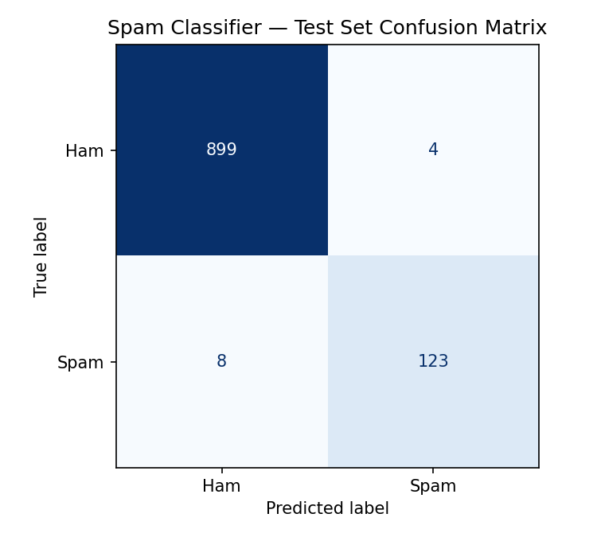
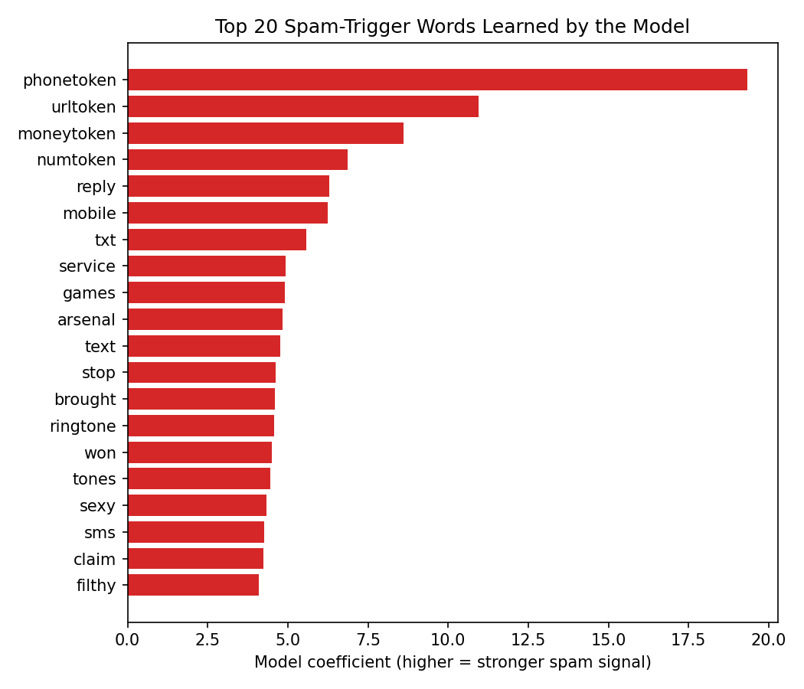

# 📧 Spam SMS / Email Classifier — "The Phishing Simulator"

**AVIP 2026 · B.Y.T.E by Arithmatrix · AI/ML Engineering · Task 2**

A machine-learning spam detector with an interactive terminal **Phishing Simulator**: type any email or message and it returns a **Spam Probability Score** and **highlights the exact keywords** that triggered the warning.

---

## 🗂 Project Structure

```
AIML_2_SpamClassifier_byte/
├── data/sms.tsv                     # dataset (auto-downloaded by train.py if missing)
├── models/spam_model.joblib         # trained model (TF-IDF + Logistic Regression)
├── outputs/
│   ├── metrics.json                 # accuracy, precision, recall, F1
│   ├── classification_report.txt    # per-class metrics
│   ├── confusion_matrix.png         # test-set confusion matrix
│   ├── top_spam_words.png           # strongest spam signals learned
│   └── example_predictions.csv      # 10 example inputs + predictions
├── spam_utils.py                    # shared text cleaning + keyword explanation
├── train.py                         # trains, evaluates and saves everything
├── phishing_simulator.py            # interactive terminal scanner (the twist)
└── requirements.txt
```

## 📊 Dataset

**SMS Spam Collection** — 5,574 real English SMS messages labelled `ham` (legitimate) or `spam`.

- Original source: UCI Machine Learning Repository — https://archive.ics.uci.edu/dataset/228/sms+spam+collection
- Citation: Almeida, T.A., Gómez Hidalgo, J.M., Yamakami, A. *Contributions to the Study of SMS Spam Filtering: New Collection and Results.* ACM DocEng 2011.
- **Access:** you don't need to download anything manually. `train.py` downloads a mirror of the dataset into `data/sms.tsv` automatically if it isn't already there.

## 🧹 Preprocessing Steps

1. Removed duplicate messages (5,574 → **5,169** unique; 653 spam / 4,516 ham).
2. Converted text to lowercase.
3. Replaced noisy patterns with placeholder tokens so the model learns the *idea* rather than one specific value: URLs → `urltoken`, email addresses → `emailtoken`, money amounts (£/$/€) → `moneytoken`, long digit runs / phone numbers → `phonetoken`, other numbers → `numtoken`.
4. Removed punctuation and special characters.
5. Removed English stop-words (*the, is, and…*) and words appearing in fewer than 2 messages.
6. Converted text into **TF-IDF** features (with sublinear term frequency).
7. Split the data **80 / 20** into train / test sets, stratified to keep the same spam ratio in both.

## 🤖 Model

- **Main model:** Logistic Regression (`C=10`, `class_weight="balanced"` to counter the class imbalance).
- **Baseline for comparison:** Multinomial Naive Bayes.
- Logistic Regression was chosen because each word gets a learned weight, which makes it possible to explain **which keywords** caused a message to be flagged. Word contribution = TF-IDF value × learned coefficient.

## 📈 Results (test set, 1,034 messages)

| Model | Accuracy | Precision | Recall | F1-score |
|---|---|---|---|---|
| Naive Bayes (baseline) | 98.36% | 100.00% | 87.02% | 0.9306 |
| **Logistic Regression (final)** | **98.84%** | **96.85%** | **93.89%** | **0.9535** |



Out of 131 spam messages, 123 were caught and 8 were missed. Only 4 of 903 legitimate messages were wrongly flagged.



## 🔍 10 Example Predictions

| # | Input message | Prediction | Spam probability | Top trigger words |
|---|---|---|---|---|
| 1 | URGENT! Your account has been suspended. Verify your details now at http://secure-bank-login.co to avoid closure. | **SPAM** | 71.9% | urltoken, urgent, account, verify |
| 2 | Congratulations! You have won a £1000 Walmart gift card. Call 09061701461 to claim your prize today! | **SPAM** | 99.7% | phonetoken, moneytoken, won, claim, prize |
| 3 | FREE entry to win an iPhone 17! Text WIN to 87121 now. T&Cs apply. | **SPAM** | 99.9% | phonetoken, win, text, numtoken, free |
| 4 | Dear customer, you are selected for a cash reward of $500. Reply YES to claim before midnight. | **SPAM** | 97.2% | moneytoken, reply, claim, customer, cash |
| 5 | Limited time offer: get 50% off all subscriptions. Click here to claim your exclusive discount now! | **SPAM** | 74.7% | claim, numtoken, click, offer, time |
| 6 | Hey, are we still meeting for lunch tomorrow at 1? | **HAM** | 0.9% | numtoken |
| 7 | Can you send me the notes from today's lecture when you get a chance? | **HAM** | 7.2% | chance, send, today |
| 8 | Hi Parmbir, the project review meeting has moved to Thursday at 3pm. See you there. | **HAM** | 2.4% | numtoken, review |
| 9 | Mum says dinner is ready, come home soon | **HAM** | 0.3% | soon |
| 10 | Thanks for the help with the assignment yesterday, really appreciated it! | **HAM** | 1.9% | help, thanks |

## 🚀 How to Run

```bash
# 1. Install dependencies
pip install -r requirements.txt

# 2. Train the model (downloads data, saves model + all outputs)
python train.py

# 3. Launch the Phishing Simulator
python phishing_simulator.py
```

In the simulator, paste or type a message, then press **Enter on an empty line** to scan it. Type `quit` to exit.

### Using the saved model in your own code

```python
import joblib
model = joblib.load("models/spam_model.joblib")   # spam_utils.py must be in the same folder
prob = model.predict_proba(["You have won a free prize! Call now"])[0][1]
print(f"Spam probability: {prob:.1%}")
```

## 📝 Summary

This project builds a spam classifier on the UCI SMS Spam Collection (5,169 unique messages after removing duplicates). Text was lowercased, cleaned, and had URLs, phone numbers, money amounts and numbers replaced with placeholder tokens, so the model generalises to new links and numbers instead of memorising specific ones. Messages were converted to TF-IDF features and split 80/20 with stratification.

A Multinomial Naive Bayes baseline reached 98.4% accuracy but only 87.0% recall, meaning it missed many spam messages. The final Logistic Regression model, with balanced class weights, reached **98.8% accuracy, 96.9% precision, 93.9% recall and an F1-score of 0.954**, catching 123 of 131 spam messages while wrongly flagging only 4 of 903 legitimate ones.

The "Phishing Simulator" twist is an interactive terminal tool that outputs a Spam Probability Score with a colour-coded risk bar, and explains its decision by multiplying each word's TF-IDF weight by the model's learned coefficient. The words that pushed the score towards spam are highlighted in the original message and ranked. Phone numbers, links, money amounts and words like *claim*, *prize*, *won* and *free* were the strongest signals.

**Limitations:** the model was trained on SMS messages, so very long or corporate-style phishing emails may score lower than they should. Training on a dedicated email dataset (e.g. Enron-Spam) would be a natural next improvement.

---
*Built for the Arithmatrix Virtual Internship Program (AVIP) 2026 — B.Y.T.E by Arithmatrix.*
